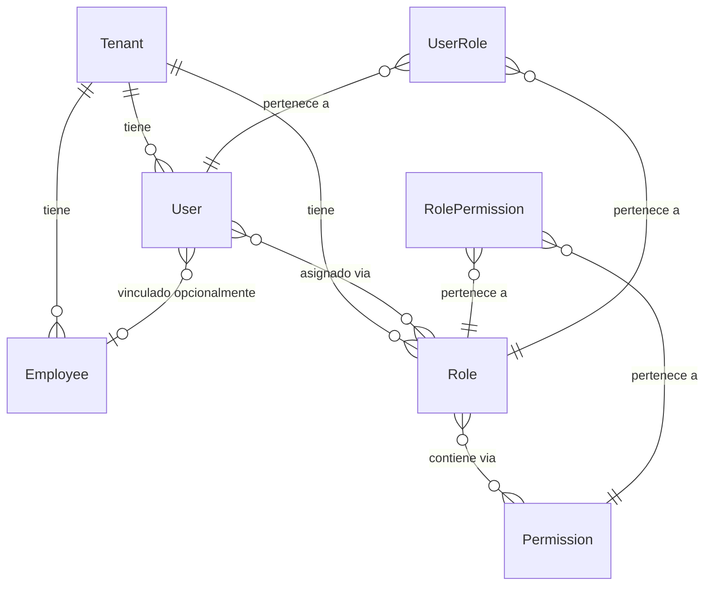

# Data Model: Core Foundations

## Entities

### Tenant (Company)

| Campo | Tipo | Descripción | Reglas |
|-------|------|-------------|--------|
| id | UUID (PK) | Identificador único | Auto-generado |
| legalName | String | Razón social | Requerido, único por país |
| taxId | String | RIF / Identificación fiscal | Requerido, único |
| baseCurrency | String (ISO 4217) | Moneda base (VED, USD) | Requerido |
| timezone | String | Zona horaria (America/Caracas) | Requerido, default UTC |
| subscriptionPlan | Enum | Plan: free, starter, business, enterprise | Default: free |
| status | Enum | Estado: active, suspended, inactive | Default: active |
| settings | JSON | Configuración específica del tenant | Opcional |
| createdAt | DateTime | Fecha de creación | Auto |
| updatedAt | DateTime | Fecha de actualización | Auto |
| deletedAt | DateTime? | Soft delete | Nullable |

**Validaciones**:
- `taxId` único global (no pueden existir dos tenants con el mismo RIF)
- No se puede eliminar físicamente un tenant con datos transaccionales
- Al crear un tenant, se debe aprovisionar su esquema/configuración base

### User

| Campo | Tipo | Descripción | Reglas |
|-------|------|-------------|--------|
| id | UUID (PK) | Identificador único | Auto-generado |
| tenantId | UUID (FK → Tenant) | Tenant al que pertenece | Requerido, indexado |
| email | String | Email del usuario | Único por tenant, requerido |
| passwordHash | String | Hash bcrypt de la contraseña | Requerido |
| name | String | Nombre completo | Requerido |
| status | Enum | Estado: active, blocked, inactive | Default: active |
| failedLoginAttempts | Int | Intentos fallidos consecutivos | Default: 0 |
| lockedUntil | DateTime? | Bloqueo temporal hasta | Nullable |
| lastLoginAt | DateTime? | Último inicio de sesión | Nullable |
| employeeId | UUID (FK → Employee)? | Vinculación opcional a Empleado | Nullable, único |
| createdAt | DateTime | Fecha de creación | Auto |
| updatedAt | DateTime | Fecha de actualización | Auto |
| deletedAt | DateTime? | Soft delete | Nullable |

**Validaciones**:
- `email` único dentro del mismo tenant (diferentes tenants pueden tener el mismo email)
- `passwordHash` mínimo 60 caracteres (bcrypt)
- `failedLoginAttempts` resetea al hacer login exitoso
- `lockedUntil` si es futuro, el login es rechazado
- `employeeId` único (un Employee solo puede vincularse a un User)

### Employee

| Campo | Tipo | Descripción | Reglas |
|-------|------|-------------|--------|
| id | UUID (PK) | Identificador único | Auto-generado |
| tenantId | UUID (FK → Tenant) | Tenant al que pertenece | Requerido, indexado |
| firstName | String | Nombres | Requerido |
| lastName | String | Apellidos | Requerido |
| identityDoc | String | Documento de identidad (cédula, pasaporte) | Requerido, único por tenant |
| hireDate | Date | Fecha de ingreso | Requerido |
| department | String | Departamento | Requerido |
| position | String | Cargo | Requerido |
| baseSalary | Decimal(15,2) | Salario base | Requerido, >= 0 |
| status | Enum | Estado: active, inactive | Default: active |
| createdAt | DateTime | Fecha de creación | Auto |
| updatedAt | DateTime | Fecha de actualización | Auto |
| deletedAt | DateTime? | Soft delete | Nullable |

**Validaciones**:
- `identityDoc` único dentro del tenant
- `baseSalary` debe ser >= 0
- Un Employee puede existir sin User vinculado
- Un Employee puede ser eliminado (soft) sin afectar al User vinculado

### Role

| Campo | Tipo | Descripción | Reglas |
|-------|------|-------------|--------|
| id | UUID (PK) | Identificador único | Auto-generado |
| tenantId | UUID (FK → Tenant) | Tenant al que pertenece | Requerido, indexado |
| name | String | Nombre del rol (Admin, Contador, etc.) | Requerido, único por tenant |
| description | String | Descripción del rol | Opcional |
| isSystem | Boolean | Rol del sistema (no editable) | Default: false |
| createdAt | DateTime | Fecha de creación | Auto |
| updatedAt | DateTime | Fecha de actualización | Auto |

**Validaciones**:
- `name` único dentro del tenant
- `isSystem=true` no permite edición ni eliminación
- Roles por defecto del sistema: `tenant_admin`, `super_admin`

### Permission

| Campo | Tipo | Descripción | Reglas |
|-------|------|-------------|--------|
| id | UUID (PK) | Identificador único | Auto-generado |
| code | String | Código del permiso (ej: `invoice.create`) | Único global, requerido |
| name | String | Nombre legible | Requerido |
| module | String | Módulo al que pertenece | Requerido |
| action | Enum | Acción: create, read, update, delete, approve | Requerido |
| description | String | Descripción del permiso | Opcional |

**Validaciones**:
- `code` único global, formato: `{module}.{action}` (ej: `invoice.create`, `user.read`)
- Los permisos se crean a nivel de sistema no a nivel de tenant

### RolePermission (Join Table)

| Campo | Tipo | Descripción | Reglas |
|-------|------|-------------|--------|
| roleId | UUID (FK → Role) | Rol | PK compuesto |
| permissionId | UUID (FK → Permission) | Permiso | PK compuesto |
| createdAt | DateTime | Fecha de asignación | Auto |

### UserRole (Join Table)

| Campo | Tipo | Descripción | Reglas |
|-------|------|-------------|--------|
| userId | UUID (FK → User) | Usuario | PK compuesto |
| roleId | UUID (FK → Role) | Rol | PK compuesto |
| createdAt | DateTime | Fecha de asignación | Auto |

## Relationships



## State Machines

### Tenant Status

```
active <--> suspended
active --> inactive (soft delete)
suspended --> active (reactivación)
```

### User Status

```
active <--> blocked (por intentos fallidos)
active --> inactive (soft delete)
blocked --> active (tras timeout o admin unlock)
```

### Employee Status

```
active --> inactive (soft delete)
```

### AuditLog

| Campo | Tipo | Descripción | Reglas |
|-------|------|-------------|--------|
| id | UUID (PK) | Identificador único | Auto-generado, `gen_random_uuid()` |
| entityType | String(50) | Tipo de entidad: User, Tenant, Employee, Role | Requerido |
| entityId | UUID | ID de la entidad modificada | Requerido |
| action | String(10) | Acción: CREATE, UPDATE, DELETE | Requerido |
| before | JSONB? | Estado anterior (NULL en CREATE) | Opcional |
| after | JSONB? | Estado nuevo (NULL en DELETE) | Opcional |
| userId | UUID | Usuario que realizó la operación | Requerido |
| tenantId | UUID | Contexto del tenant | Requerido |
| ipAddress | INET? | Dirección IP del solicitante | Opcional |
| userAgent | String(255)? | User-Agent del navegador | Opcional |
| createdAt | TIMESTAMPTZ | Momento de la operación | Default `NOW()`, inmutable |

**Inmutabilidad**:
- Solo INSERT permitido (no UPDATE ni DELETE, ni siquiera super-admin)
- Enforced via RLS policy a nivel DB
- `createdAt` con DEFAULT NOW() y NOT NULL — no se puede falsear
- Contraseñas y datos sensibles se excluyen de `before`/`after` (se reemplazan con `"***"`)

**Índices**:
- `(tenant_id, created_at DESC)` — consultas por tenant
- `(entity_type, entity_id, created_at DESC)` — historial de una entidad
- `(user_id, created_at DESC)` — acciones de un usuario

**Generación**: Interceptor NestJS captura `before`/`after` state automáticamente en cada mutación.

## Audit Trail (soft deletes + log)

Todas las entidades core (Tenant, User, Employee, Role) usan soft delete:
- `deletedAt` timestamp en lugar de DELETE físico
- Consultas estándar filtran `WHERE deletedAt IS NULL`
- Consultas de auditoría pueden incluir registros eliminados

Además, todas las mutaciones (CREATE, UPDATE, DELETE) en Tenant, User,
Employee, Role, RolePermission, UserRole generan un registro de auditoría
inmutable con:

| Campo | Descripción |
|-------|-------------|
| entityType | Tipo de entidad modificada |
| entityId | ID de la entidad |
| action | create / update / delete |
| before | Estado anterior (JSON) |
| after | Estado nuevo (JSON) |
| userId | Usuario que realizó la operación |
| tenantId | Contexto del tenant |
| timestamp | Momento de la operación |
